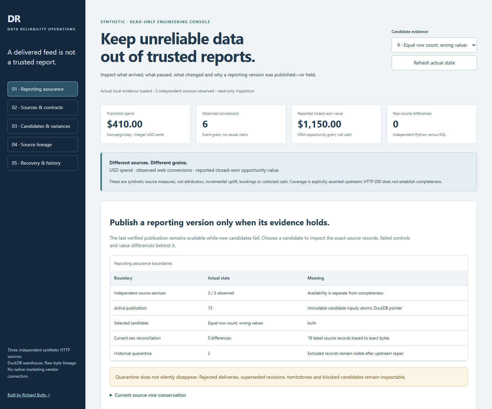

# Executed multi-source reliability evidence

The current capture is `run02`. It records actual local HTTP ingestion from three independently persisted synthetic sources, the original DuckDB engine, independent raw-source reconciliation and the real operator console. There is no native marketing-platform integration or commercial result.

- [Executed scenario, source bytes, rejected candidates and warehouse snapshots](run02/acceptance.json)
- [Environment, named regression cases and exact executed source hashes](run02/verification.json)
- [Eight rerun original process-death experiments](run02/original-recovery.json)
- [Fresh original warehouse demonstration](run02/original-demo/report.md)
- [Browser assertions, accessibility observations and screenshot provenance](run02/browser/browser.json)
- [Wheel code, SQL and UI asset verification](run02/wheel-verification.json)
- [Immutable capture SHA-256 inventory](run02/artifact-integrity.json)
- [Original-file preservation inventory](original-files.json)

## What reconciles

The final reporting version contains six campaign/day rows. Its independently reconstructed totals are **USD $410 spend, six observed conversions and USD $1,150 reported closed-won CRM value**. The CRM model retains two current opportunity records. These measures are separate grains; none is collected cash, incremental lift or causal attribution.

Accepted unique-delivery rows reconcile as **31 = 27 admitted versions + 2 semantic duplicate rows + 2 quarantined rows**. The 27 versions reconcile as **8 superseded + 19 latest**, including two current tombstones and 17 live records. All 19 latest records resolve to exact source bytes and one-based lines. Eleven source positions have independently readable acknowledgments; acknowledgment includes an accounted rejection and is not publication approval.

The candidate named **Equal row count, wrong values** retains a one-cent spend error, the same six-row count and a failed publication attempt. The final correct version does not erase that candidate. Other held versions retain source outage, stale coverage, missing references, incompatible schema, incomplete periods and changed-source findings. Affected-date and full rebuilds agree with the independently reconstructed table.

## Actual browser captures



[Candidate and exact variance desktop capture](run02/browser/candidate-variance.png) · [Mobile source inspection](run02/browser/operations-mobile.png)

The 73 browser assertions include keyboard navigation, 25 responsive states, candidate selection, actual source-acknowledgment readback, rejected raw input, raw lineage and failure rendering. Ten automated accessibility states include strict rule-specific follow-ups for initially clipped text. A browser-intercepted 503 tests the rendering of an unavailable view; it is explicitly separate from the actual source-HTTP outage regression. Screenshots are captured after successful real-state loading, with no image editing or invented outcomes.

The earlier successful Windows capture remains unchanged under `run01`. The current `run02` capture additionally verifies the refined dense-table layout and mobile viewport composition.

## Preserved failed experiments

- [Earlier draft mobile recovery table](failed-browser-01/outcome.json): three unresolved visibility/contrast findings. Full messages were moved into expandable run evidence; the raw failed report and images remain intact.
- [Linux mobile currency capture](failed-linux-browser-01/outcome.json): five unresolved currency-card visibility findings. Responsive sizing corrected the UI; no accessibility rule was disabled.

The implementation also corrected a demonstrated Windows controller-lock error path and rejected boolean/float acknowledgment identities that Python dictionary equality could alias to integer sequence 1. Those failures and their corresponding regression tests are distinct from successful native source execution. GitHub preserves the intermediate failed jobs; final-head status is reported in the pull request.

## Recheck

```bash
python scripts/check_operations.py
```

This validates the current execution-source bytes and capture hashes, exact retained source payloads, per-line accounting, independent receipt identities, preserved wrong-value evidence, final reconciliation and browser/image integrity. The 33 protected original engine, test, fixture and historical-evidence files remain identical to base main `eacc09acfc7c57eec2cde3f3533efc8c6b1e54db`. The older root evidence manifest describes that historical release; current manifests are generated separately by fresh verification and packaging.

For new execution, use the [full verification command](../../reliability-operations.md#verification-and-evidence), always with new paths. Docker execution is a separate Linux CI lane; the local Windows host has no Docker CLI. No local test is represented as container execution, and no synthetic source is represented as a native vendor.
