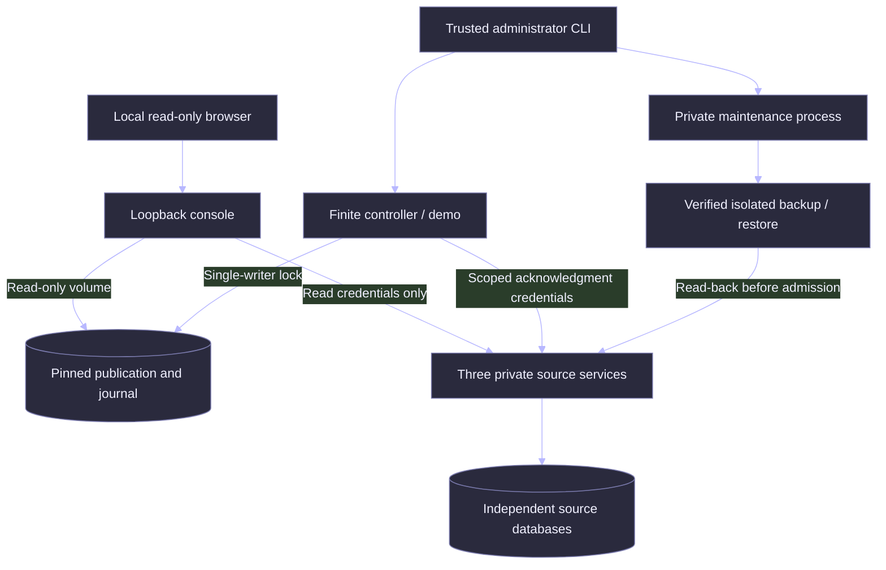

# Operational application delivery

The existing pipeline already executes source admission, recovery, coverage gates, an independent arithmetic path and atomic publication. This extension addresses the operating boundary: can an isolated deployment start with restricted identities, expose truthful readiness, survive a restart and recover a verified publication without assuming the independent sources were also rolled back?

## Implementation scope

1. Preserve the original financial grain, contracts, SQL, fixtures, controller and historical evidence.
2. Pin the runtime image by digest and Linux dependency wheels by SHA-256. Apply bounded container CPU, memory, process and log settings.
3. Separate process liveness from independent publication readiness; add structured request telemetry and an inspectable operating view.
4. Add private, quiescent publication backup and isolated restore with content, implementation and independent-source checks.
5. Execute local services/browser failure acceptance and a separate Linux container lane. Preserve failures and publish source-bound records.

## Deployment and trust boundaries

Only `127.0.0.1:8602` is published. The console has no mutation endpoint, acknowledgment token, source database mount or controller configuration. Its publication/configuration volumes are read-only. Source services share an internal Docker network and publish no host ports. The maintenance profile has publication write access and read-only source credentials; running it requires Docker/host administrative access. It never runs through a browser request.

This is an isolated operator application, not an Internet-ready authenticated tenant service. Local browser reads need no login because the inputs are synthetic and access is loopback-only. Source read and acknowledgment credentials are distinct random 32-byte URL-safe tokens, compared in constant time. Startup rejects write credentials in the console configuration and reused source scopes. Filesystem permissions and Docker access protect privileged commands; application-level administrator authentication is not claimed. Do not change the bind address or add a public proxy without a separate security review and authentication/TLS design.

## Truthful health and telemetry

- `/livez` (and legacy `/health`) reports only that the process can answer. An unavailable source does not masquerade as a dead console.
- `/readyz` and read-only `/api/operations` return 200 only after independent receipts/checkpoints, raw-source arithmetic, published state and exact source inventories agree. A changed coverage claim can cause 503 without changing the number of deliveries.
- Reporting freshness retains the candidate's **synthetic business as-of date**. These are historical finite feeds, not current source SLAs. HTTP 200 and a recent readiness observation do not make the business data current.
- A failed readiness check holds deployment admission, not historical inspection. A source outage can leave the prior verified publication readable. An unhealthy Docker check does not automatically authorize a rebuild or restart.
- HTTP logs contain only a server-generated request ID, known service/route classification, status, duration and timestamp. They exclude request headers, bodies, query values, addresses and exception tracebacks. Request IDs appear in response headers; cross-service distributed tracing is not claimed.
- Each process admits at most 16 request handlers, bounds socket I/O to five seconds and closes overload connections with 503. This is an admission bound, not a throughput or latency benchmark.

Sequential independent reads do not create a distributed transaction. Readiness is an observation of pinned state, not a guarantee that a source cannot change immediately afterward. Publication retains its original controller gates. Python optimization is unsupported because existing verification uses assertions; readiness fails closed under `python -O`.

## Backup boundary

The maintenance command acquires the controller's exclusive lock, verifies readiness, refuses an uncheckpointed DuckDB WAL, copies the closed publication state and uses SQLite's backup API for the journal. It independently verifies the isolated copy against the still-running independent sources, rechecks inventories, validates all file hashes and atomically finalizes a fresh archive directory. It closes SQLite handles explicitly, including on Windows.

Archives contain publication/raw-data state, not service configuration or credentials. They are private data, never CI artifacts. Restore requires a new destination, the matching implementation fingerprint, exact file inventory and fresh independent-source acceptance. Changed coverage or remote-ahead deliveries prevent admission. Failed copies remain diagnostic candidates; no active configuration is switched and no controller resumes automatically.

This is **publication-state recovery**, not source-database disaster recovery, point-in-time cloud recovery or an online distributed backup. Source writers must be quiescent throughout capture; remote inventory comparisons detect observed changes but cannot freeze an uncooperative source. Archive manifests require trusted storage and an externally retained digest; an attacker who can replace the archive and its manifest is outside this integrity boundary.

## Acceptance and remaining boundaries

[Executed engineering report](evidence/delivery/README.md) separates Windows subprocess/browser acceptance from Linux container execution. [Operating procedures](deployment-runbook.md) cover startup, stop, restart, backup, restore and release rollback.

No hosted dynamic service, native marketing vendor connector, production traffic, human usability acceptance, online schema migration, image-version rollback, penetration test or production availability SLA is established by local tests. Hosted acceptance requires an approved host, private ingress/access design and explicit authorization for exposure or charges. A static GitHub Pages export would not satisfy that requirement. No hosting credentials or paid resources are required for the reproducible core.
