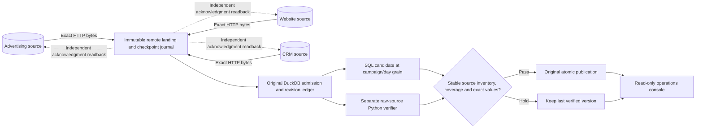

# Multi-source Data Reliability Operations

The operating extension asks a separate question from the original warehouse: **did each declared source deliver a stable, complete-enough reporting inventory, and can that inventory support a new publication?** The original DuckDB admission, revision, SQL and atomic publication implementation remains unchanged. Its Python-only workflow and eight historical subprocess experiments are preserved.

## Run the console

```bash
docker compose up --build
```

Open [Data Reliability Operations](http://127.0.0.1:8602/). The finite synthetic harness executes before the read-only console starts. No vendor account, cloud subscription or external API credential is required.

```bash
docker compose exec -T console python -m reliability_ops.verify --config /console-config/console.json
docker compose down
```

Ordinary restarts preserve source identities, acknowledgments, warehouse versions and the executed acceptance record. A changed fixture or implementation requires an explicitly fresh demo. `docker compose down --volumes` destroys only this Compose project's disposable demonstration data and generated credentials. It is not a production recovery operation.

Without Docker, from the repository root with Python 3.12:

```bash
python -m pip install -r requirements-operations.lock
python -m pip install --no-deps --no-build-isolation -e .
python -m reliability_ops.demo --workspace work/operator-demo-01 --serve
```

The workspace must be new. Ctrl+C stops the owned source and console processes. Credentials and databases remain private under ignored `work/`; do not publish that directory. For browser verification install Chromium with `python -m playwright install chromium`.

## Sources, ownership and grain

| HTTP service | Owned feeds | Source grain | Reporting meaning |
|---|---|---|---|
| Advertising | `campaigns`, `paid_media` | Campaign reference; stable spend/counter fact ID | Campaign label; reported USD spend, impressions and clicks |
| Website | `web` | Event ID and revision | Observed conversion flag, 0 or 1 |
| CRM | `crm` | Opportunity ID and revision | Reported closed-won value at its supplied recognition date |

These are supplied relationships, not causal attribution or independent proof that a CRM win occurred. Reported CRM value is not booked revenue or collected cash. No cash model exists. Each feed uses the original [closed field contracts](contracts.md), including explicit paid-media v1/v2 compatibility and USD integer cents. Unsupported v3 remains rejected until an explicitly linked supported delivery resolves it; nothing silently upgrades a schema.

A repair link is a producer assertion resolving or withdrawing a failed delivery, not independent proof that two payloads mean the same thing. The original rejected bytes and their exclusion remain visible.

Every service has its own SQLite database, read token, acknowledgment token and monotone delivery sequence. A service cannot supply another owner's admitted facts merely by changing an envelope's `source`. The controller retains an ownership rejection outside the warehouse rather than passing it into the original trusted-input API.



## HTTP contract and durable checkpoints

`GET /v1/catalog` returns contract version 1, a pinned service identity, the complete finite sequence of immutable delivery metadata and versioned coverage assertions. The client rejects wrong ownership, missing positions, malformed schemas, oversized responses and redirects. Catalog and raw delivery responses are bounded to 2 MB; a catalog supports at most 1,000 positions/assertions. This is a finite local contract, not a vendor pagination or throughput claim.

`GET /v1/delivery/{seq}` must match the catalog's exact SHA-256 and byte length. The controller durably lands those bytes before admission. Immutable `(service, sequence)` identity cannot be rebound to another hash. The original warehouse then returns an accepted/rejected receipt; quarantined rows remain distinct from whole-delivery rejection.

`POST /v1/ack` records only the exact consumed source position and hash. A read credential cannot perform it. `GET /v1/ack/{seq}` independently verifies the acknowledgment and its stable content identity. Acknowledgment means **consumed with an accounted disposition**, including rejection; it does not approve a reporting version. Lost acknowledgments are read back before another POST. At most three new POST reservations are durably committed per position; unknown readback never means absence. The checkpoint advances only after both warehouse disposition and independent source receipt are established. An ingestion-process crash after DuckDB commit replays the same bytes and recovers the existing receipt without inserting duplicate versions.

Exact transport replays can have multiple source positions pointing to one warehouse file receipt. Accepted-row conservation therefore counts unique admitted delivery hashes, not the number of HTTP requests. Semantic duplicate rows, quarantined rows, rejected files, superseded revisions and current tombstones have separate accounting.

## Coverage and publication fences

Each coverage assertion binds an owner/feed, identity/revision, inclusive reporting interval, explicit completeness flag and exact ordered delivery-hash inventory. The latest revision of each assertion identity is retained. Multiple competing identities for a feed block publication rather than selecting the most convenient assertion. Missing intervals, incomplete assertions, unprocessed positions, unrepaired rejection or inventory mismatch hold the candidate. These are synthetic producer assertions, not proof of real upstream completeness.

The wrapper captures source pins and accepted delivery hashes for each candidate. The original engine continues to pin its ingestion epoch, base publication, inputs, implementation and freshness date. Publication repeats raw-source reconciliation and rechecks the remote inventories, then uses the original atomic DuckDB publication transaction. A changed source, wrong value, unresolved campaign, stale plan or changed candidate leaves the last verified version intact.

The source checks are sequential fences, not a transaction across three remote services. A remote source can advance after its final check. The published report is a verified version of the pinned inventory, not a guarantee of globally instantaneous source freshness. The explicit run date and reporting interval are synthetic business coordinates, not today's wall-clock SLA. An old publication is retained and does not automatically expire.

## Independent verification and models

The new verifier starts from retained raw delivery bytes. It independently reconstructs per-line outcomes, deduplicates exact source revisions, selects revision winners before date aggregation, preserves tombstones and resolves source lineage. It uses the established field validator for normalization but does not call the warehouse SQL or its existing Python aggregation. Source-specific arithmetic separately accumulates spend, event conversions and opportunity value at campaign/day grain.

It compares full rows and every value, not merely record counts or grand totals. A deliberately corrupted candidate has the correct row count and a one-cent spend error; that exact difference remains inspectable. Affected-date and independent full rebuilds must both match the raw-source result. Source-record before/after explanations retain moved dates, revisions and deletions.

[Additional SQL views](../src/reliability_ops/views.sql) expose opportunity/day grain, contract dispositions and publication history. The original analytical SQL remains authoritative. dbt is not added: explicit source contracts, one model, transaction boundaries and independent tests are clearer than a decorative second execution framework here.

## Console and trust boundary

Five views inspect reporting assurance, actual source status and coverage, contract failures, candidates and exact variances, raw lineage, and recovery/publication history. Controls select evidence, read source receipts and retrieve hash-verified input bytes. All console routes are read-only; rejected source data and failed candidates stay visible. Source unavailability is labeled unknown while the last verified report remains inspectable. Warehouse busy/unverified responses clear stale rendered metrics.

Only port 8602 is published, on loopback. Sources remain on the internal Compose network. The console also joins a host-accessible bridge and mounts warehouse data and its separate read configuration read-only; it receives no acknowledgment tokens or source database volumes. All application containers run as a non-root user with capabilities dropped and read-only roots. The trusted finite harness alone has source storage access for fault injection; there is no public fault endpoint.

This is a serialized local controller with DuckDB's single-writer limit, not a distributed orchestrator. SQLite files are separate persistence boundaries on one host, not independent hardware or native SaaS. Local tokens and filesystem isolation are not production SSO, tenant RLS, TLS, an egress firewall or protection from the host administrator. A partial interruption of the fixture harness is not silently reset: use the explicit persisted ingestion/build recovery, or recreate only the disposable demo after reviewing its state.

The legacy CLI remains a separate trusted file-ingestion path and does not enforce the new HTTP inventory fences. Source-driven publication uses the operating wrapper. This preserves the original contract rather than presenting the extension as isolation from hostile local code.

## Verification and evidence

```bash
python scripts/verify_operations.py --workspace work/acceptance-01 --output work/evidence-01
```

Both paths must be new. This executes the unchanged original suite, operating regressions, two byte-compared original demonstrations, eight original crash experiments, the actual HTTP scenario, independent receipts/reconciliation and the real console in Chromium. It records responsive checks, automated accessibility findings and genuine screenshots. Git is optional; exact source hashes remain recorded when running a source archive.

Historical records under `docs/evidence/` are retained unchanged. Original-engine verification now writes to `work/original-verification/`, including the current package manifest; the historical manifest remains an archive. The [preservation inventory](evidence/operations/original-files.json) binds 33 original engine, test, fixture and evidence files to main `eacc09a`. New execution records and their byte hashes are added separately. Local native execution, Linux/Windows CI and container execution are separate evidence lanes. Automated accessibility checks supplement visual inspection, not universal accessibility certification.
